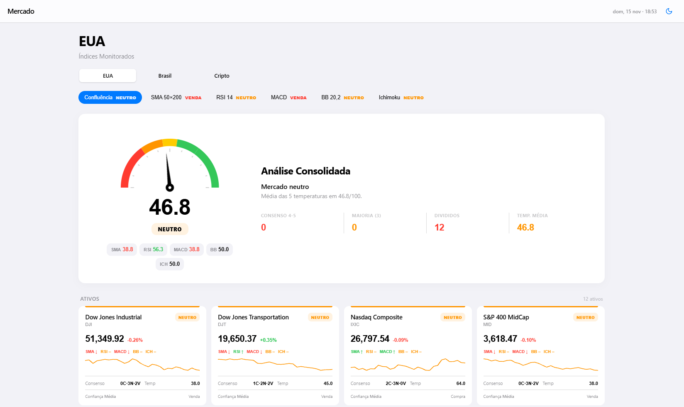
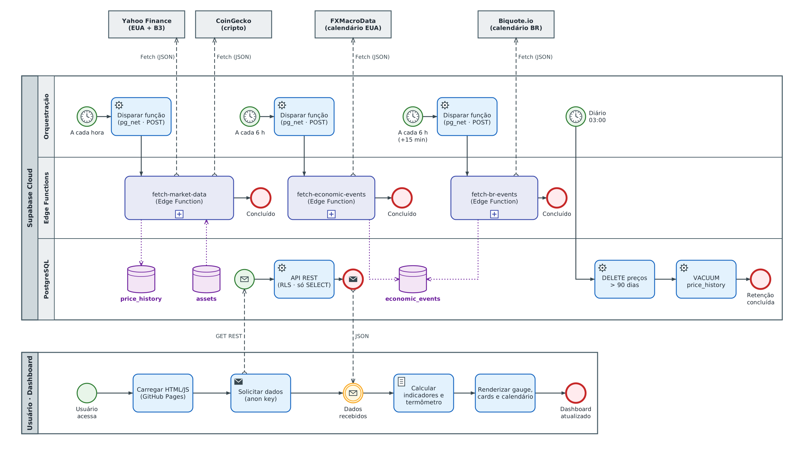
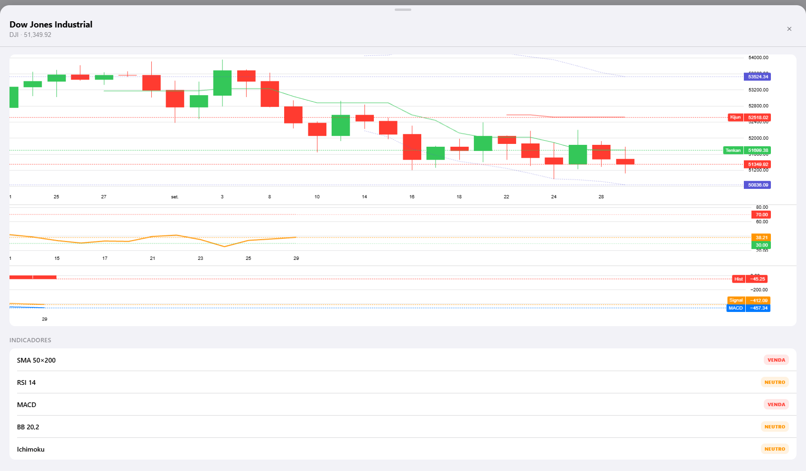

# Market Dashboard

Dashboard web que acompanha índices dos EUA, ações da B3 e criptomoedas e resume cinco indicadores técnicos em um termômetro de 0 a 100. Os preços ficam em um banco PostgreSQL (Supabase) e o navegador calcula os sinais ao abrir a página.



## O que o dashboard faz

- Monitora 36 ativos: 12 índices dos EUA, 12 ações da B3 e 12 criptomoedas.
- Coleta preços a cada hora e calendários econômicos a cada 6 horas.
- Gera, para cada ativo, o voto de cinco estratégias: compra, neutro ou venda.
- Reúne os votos em um termômetro por mercado e em uma confluência por ativo.
- Mostra os eventos econômicos de hoje e de amanhã (EUA e Brasil).
- Abre um gráfico detalhado do ativo com os indicadores sobre o preço.

A tela tem três abas (EUA, Brasil e Cripto), uma linha de chips com o veredito de cada estratégia, o termômetro, os cards dos ativos e o calendário. Cripto não tem calendário.

## Como funciona



1. O `pg_cron` dispara as Edge Functions pelo `pg_net`: preços a cada hora, calendário dos EUA a cada 6 horas e calendário do Brasil a cada 6 horas, 15 minutos depois.
2. As funções consultam as APIs externas e gravam em `price_history` e `economic_events`.
3. Todo dia às 03:00 uma rotina apaga preços com mais de 90 dias e roda `VACUUM`.
4. O navegador lê as tabelas com a chave `anon`. O RLS só permite leitura; a escrita é feita apenas pelas funções, com a chave `service_role`.
5. O próprio navegador calcula os indicadores e desenha a tela.

## Indicadores

Cada estratégia vota em compra, neutro ou venda para cada ativo.

| Indicador | Voto de compra | Voto de venda | O que mede |
|---|---|---|---|
| SMA 50×200 | SMA50 mais de 0,1% acima da SMA200 (Golden Cross) | SMA50 mais de 0,1% abaixo da SMA200 (Death Cross) | Tendência |
| RSI 14 | RSI ≤ 30 (sobrevenda) | RSI ≥ 70 (sobrecompra) | Reversão |
| MACD | Linha MACD acima do sinal e acima de zero | Linha MACD abaixo do sinal e abaixo de zero | Momento |
| Bollinger 20,2 | %B ≤ 0,2 (preço perto da banda inferior) | %B ≥ 0,8 (preço perto da banda superior) | Reversão à média |
| Ichimoku | Preço acima da nuvem e Tenkan acima da Kijun | Preço abaixo da nuvem e Tenkan abaixo da Kijun | Tendência e posição |

Nos cards, RSI, MACD, Bollinger e Ichimoku são aproximações calculadas a partir de SMA50, SMA200 e preço (ver [Limitações](#limitações)). O gráfico de detalhe usa o cálculo convencional.

## Como a confluência é calculada

**Por ativo.** Cada voto vale 85 (compra), 50 (neutro) ou 20 (venda). A temperatura do ativo é a média dos cinco votos. O sinal final é compra ou venda quando pelo menos 3 estratégias concordam e superam as opostas. Caso contrário, é neutro.

| Votos iguais | Classificação no painel |
|---|---|
| 4 ou 5 | Consenso |
| 3 | Maioria |
| menos de 3 | Dividido |

A confiança do card depende da diferença entre votos de compra e de venda: 3 ou mais é alta, 1 ou 2 é média, 0 é baixa. O card mostra os votos como `C·N·V` (compra, neutro, venda).

**Por mercado.** A temperatura de cada estratégia é a média das temperaturas dos ativos do mercado. O termômetro é a média das cinco temperaturas.

| Termômetro | Leitura |
|---|---|
| 70 ou mais | Viés de compra forte |
| 55 a 70 | Viés de compra moderado |
| 45 a 55 | Mercado neutro |
| 30 a 45 | Viés de venda moderado |
| abaixo de 30 | Viés de venda forte |

## Como analisar

1. Escolha o mercado (EUA, Brasil ou Cripto).
2. Leia o termômetro e a faixa. Ele indica o viés geral, não um ativo específico.
3. Veja os chips e as cinco temperaturas abaixo do termômetro. Compare as estratégias de tendência (SMA, MACD, Ichimoku) com as de reversão (RSI, Bollinger). Quando discordam, o mercado está em transição ou lateral.
4. Confira o painel: quantos ativos estão em consenso, em maioria ou divididos. Muitos ativos divididos enfraquecem o viés do termômetro.
5. Escolha os ativos com consenso nos cards, com confiança alta e votos `C·N·V` alinhados.
6. Abra o ativo e confirme no gráfico: preço em relação às médias e às bandas, RSI e MACD.
7. Consulte o calendário antes de decidir. Eventos de impacto alto perto do horário podem invalidar o sinal.



O resultado da análise é um viés para o mercado, uma lista de ativos candidatos e as datas de eventos que exigem atenção.

## Exemplo hipotético

Mercado dos EUA com 12 ativos. Os números abaixo são fictícios e seguem as regras acima.

| Estratégia | Compra | Neutro | Venda | Temperatura |
|---|---|---|---|---|
| SMA | 8 | 3 | 1 | 70,8 |
| RSI | 1 | 10 | 1 | 50,4 |
| MACD | 7 | 4 | 1 | 67,9 |
| Bollinger | 2 | 9 | 1 | 53,3 |
| Ichimoku | 7 | 5 | 0 | 70,4 |

O termômetro marca **62,6**, ou seja, viés de compra moderado. SMA, MACD e Ichimoku (tendência) estão altistas e RSI e Bollinger (reversão) estão neutros. Leitura: tendência de alta sem excesso de compra.

Dois ativos do painel:

- **Ativo A:** 4 compras, 1 neutro, 0 vendas (`4C·1N·0V`). Temperatura 78,0, consenso, confiança alta, sinal de compra. É um candidato para abrir o gráfico e confirmar.
- **Ativo B:** 2 compras, 1 neutro, 2 vendas (`2C·1N·2V`). Temperatura 52,0, dividido, confiança baixa. Fica fora da lista.

Se houver um evento de impacto alto nos EUA no mesmo dia, a decisão espera o resultado.

## Tecnologias

| Camada | Tecnologia |
|---|---|
| Banco | Supabase PostgreSQL com RLS |
| Coleta | Supabase Edge Functions (Deno e TypeScript) |
| Agendamento | `pg_cron` e `pg_net` |
| Fontes de dados | Yahoo Finance (índices e ações), CoinGecko (cripto), FXMacroData (calendário EUA), Biquote (calendário Brasil) |
| Front-end | HTML, CSS e JavaScript em um único `index.html`; `supabase-js` carregado pelo jsDelivr |
| Gráficos | TradingView Lightweight Charts 4.1.0 |
| Visual | Tokens de CSS inspirados no iOS, com tema claro e escuro |

## Como executar

Requisitos: conta no Supabase e [Supabase CLI](https://supabase.com/docs/guides/cli).

```bash
# 1. Banco: execute supabase/schema.sql no SQL Editor do Supabase

# 2. Funções
supabase login
supabase link --project-ref <PROJECT_REF>
supabase functions deploy fetch-market-data     --no-verify-jwt
supabase functions deploy fetch-economic-events --no-verify-jwt
supabase functions deploy fetch-br-events       --no-verify-jwt

# 3. Agendamento: troque os placeholders em supabase/cron.sql e execute no SQL Editor

# 4. Front-end: preencha SUPABASE_URL e SUPABASE_ANON_KEY no index.html
#    e publique o arquivo (por exemplo, no GitHub Pages)
```

As funções validam o cabeçalho `Authorization` contra a `service_role`, por isso o `verify_jwt` fica desligado.

## Autor e licença

Desenvolvido por **Halyf Soares**. Licença [MIT](LICENSE).

Este projeto tem finalidade educacional e analítica. Nada aqui é recomendação de compra ou venda de ativos.
